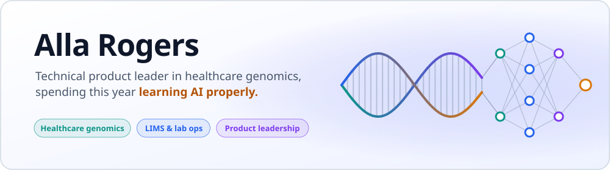
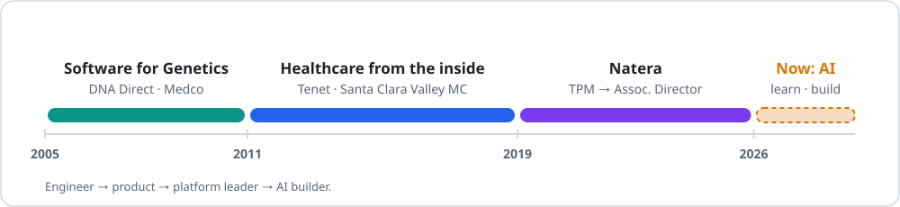
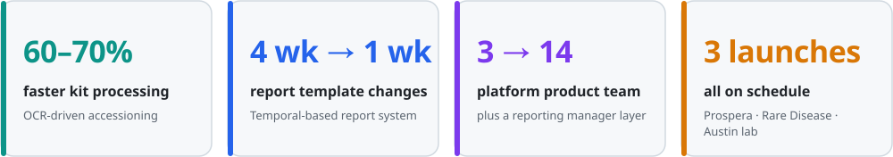
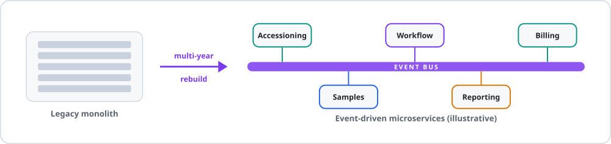
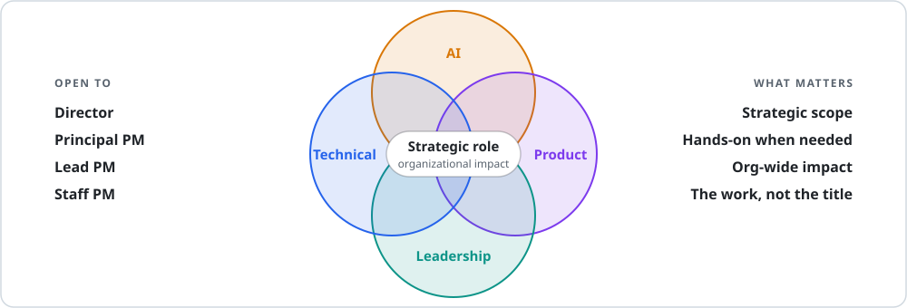

  

  
  
  

### I spent seven years building the software that runs a genomics lab, from the first Prospera launch to a multi-year rebuild of the core LIMS. Now I'm on a deliberate break to go past "ask the LLM" and learn how models, retrieval (RAG) and tool protocols (MCP) fit together in real systems. **This repo is where I build and document that.** Next up: a strategic product role where I can bring my technical, product, leadership and AI skills together. It's about the work and the impact, not the title.

 

## 🧭 Career arc

<table>
  <tr>
    <td width="33%" valign="top">
      <h3>🧬 Software for Genetics</h3>
      <b>2005 – 2011</b> · DNA Direct · Medco
      
At DNA Direct, a direct-to-consumer genetic testing startup, I was the <b>only technical person in the company</b> and owned the Java/Spring/Hibernate platform end to end: patient portal, e-commerce, internal CRM. I also represented the technology in Series B investor discussions.

      
At Medco I moved into product and built <b>pharmacogenomic decision-support tools</b>.

    </td>
    <td width="33%" valign="top">
      <h3>🏥 Healthcare from the inside</h3>
      <b>2011 – 2019</b> · Tenet · Santa Clara Valley MC
      
I wanted to understand why genetic tests weren't standard of care, so I went to the side of healthcare that moves the data.

      
I led interface work for <b>900+ providers</b> at Tenet, including the interface migration for the Tenet–Baylor Scott &amp; White merger. At Santa Clara Valley Medical Center I built <b>Epic integrations</b> for lab and device systems.

    </td>
    <td width="33%" valign="top">
      <h3>🔬 Natera</h3>
      <b>2019 – 2026</b> · TPM → Associate Director
      
I joined as a technical product manager and was promoted to <b>Associate Director, Technical Product Management</b>.

      
Seven years building the software that runs a genomics lab. Highlights in <a href="#-natera-accomplishments">Natera accomplishments</a>.

    </td>
  </tr>
</table>

 

## 🏆 Natera Accomplishments

- 🚀 Launched **Prospera**, **Rare Disease** and the **Austin lab** on schedule.
- 🏗️ Led the move of Natera's core **LIMS** from a legacy monolith to **event-driven microservices**.
- 📄 **OCR-driven accessioning** cut kit processing time by **60–70%**.
- ⏱️ A **Temporal-based Report Management System** cut report template changes from **4 weeks to 1**.
- 👥 Grew the platform product team from **3 to 14**, with a reporting manager layer.
- 📊 Built a **prioritization framework** that Engineering later adopted as the base of its project planning process.

 

## 🛠️ What I'm working on now

Mini projects live in this repo.

<table>
  <tr>
    <td width="50%" valign="top">
      
      <b>BuilderBuddy</b> 
      Helps homeowners decide which storage system to buy for their needs.
      <!-- TODO: link to the project folder, e.g. <a href="./builderbuddy">BuilderBuddy</a> -->
    </td>
    <td width="50%" valign="top">
      
      <b>Drug360</b> 
      A prototype drug interaction checker.
      <!-- TODO: link to the project folder -->
    </td>
  </tr>
  <tr>
    <td width="50%" valign="top">
      
      <b><a href="https://github.com/allarogers/job-search-skills">AI Job Search Skills</a></b> 
      A skill toolkit to help with job searching.
    </td>
    <td width="50%" valign="top">
      
      <b>DoorDash Receipt Scraper</b> 
      Summarizes all DoorDash orders for an insurance claim.
      <!-- TODO: link to the project folder -->
    </td>
  </tr>
</table>

### Alongside the builds

<table>
  <tr>
    <td width="50%" valign="top">
      
      <b>Learning AI beyond the basics</b> 
      I started by asking an LLM to draw me a map of the field. That map became <a href="#">AI Landscape</a>, and the longer story is in <a href="#">My AI journey</a>.
    </td>
    <td width="50%" valign="top">
      
      <b>Practicing leadership</b> 
      Completed UC Berkeley Haas's <i>Digital Transformation: Leading People, Data &amp; Technology</i> (May 2026), run an executive communication group, and volunteer as a program manager for a community of women in tech.
    </td>
  </tr>
</table>

 

## 🎯 Where I'm headed

**It's not about the title, it's about the work.** I'm looking for a strategic role, whether that's Director, Principal, Lead or Staff PM, where I can apply my full background: technical, product, leadership, and my newly learned AI skills. I don't shy away from hands-on work; what I care about is organizational impact.

I care about getting new technology into the hands of providers **without adding to their workload**. I have a few ideas brewing in that space and I want to build them inside a team that ships.

  <a href="ABOUT_ME_LONG.md"><b>📖 Read the long version →</b></a>

